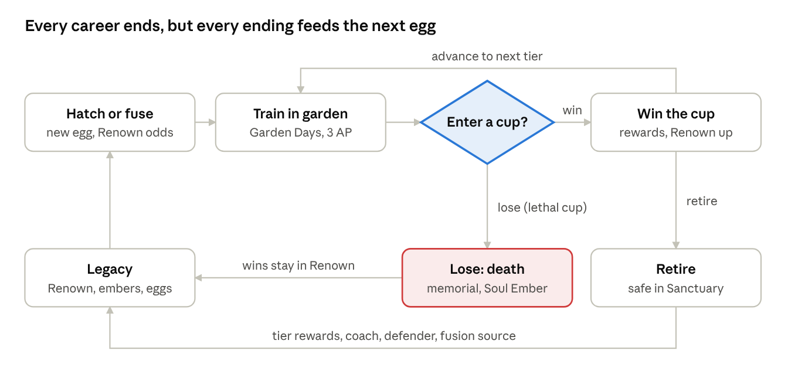
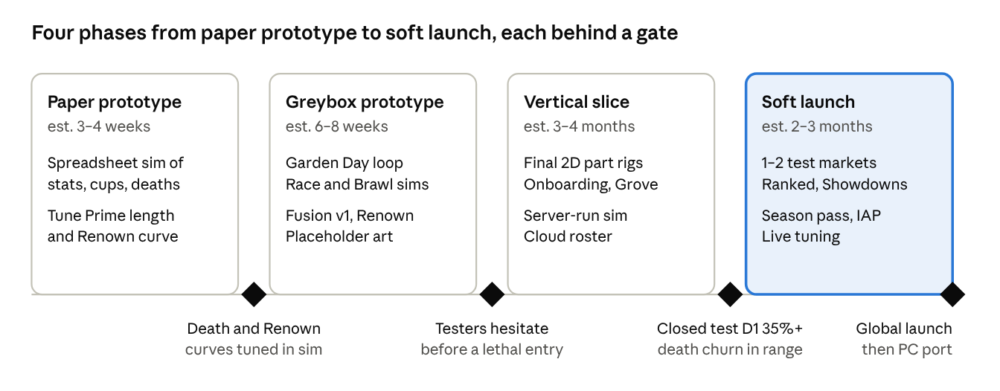

# Monster Garden Roguelite — Game Design Document v0.1

Oct 3, 2026 · @Steve Kuykendall · Working title TBD

This is a mobile creature-collector roguelite. Players raise monsters in a safe garden, then decide which ones to risk in competitions where a loss is permanent death. The table below locks in the team's answers to the first round of questions. Everything after it builds on them.

## Decisions so far

| Area | Decision | What it means for the design |
| --- | --- | --- |
| Platform | Mobile first (iOS/Android), PC later | Portrait-friendly UI, 5–15 minute sessions, touch-only controls |
| Competition style | Monsters compete on their own; players influence | Preparation is the skill. Async online play works because no live input is needed |
| Time | Session-only: nothing decays while away | Pressure comes from risk and a limited career length, not care timers |
| Stakes | Losing a lethal competition kills the monster. Bronze cups are non-lethal, for onboarding | Players amass a roster and protect favorites. Every entry is a real decision |
| Run structure | A run is one monster's career up a cup ladder | Push-your-luck: retire and bank rewards, or advance |
| Meta-progression | Hidden win counter: account-wide Renown plus a lineage bonus | A death costs something, but progress keeps adding up |
| Fusion | Combining two monsters uses up both | The main way to build better monsters, and the main sink for surplus monsters |
| Online | Ranked async PvP is safe; opt-in Habitat Showdowns are lethal | A defending player's real monster is never at risk |
| Business model | Free-to-play: cosmetics plus a season pass | Nothing that affects power or survival is for sale |
| Team / engine | 1–5 people, Godot | Tight MVP; 2D modular art; small backend footprint |

## Vision and pillars

**Elevator pitch:** Chao Garden meets a roguelite. Hatch and raise one-of-a-kind monsters, train them for competitions they play out themselves, and choose who you're willing to risk. Losers die, winners make your whole garden luckier, and fusion turns your veterans into something stronger.

**Setting: the Great Heap.** Everything in this world eventually returns to the Great Heap, an ancient, steaming, slightly sentient compost mountain. The Heap hatches new eggs from whatever it receives, and the cups are a festival held in its honour. This makes the core loop literal: losers "go to the Heap", their wins are "remembered by the Heap" (Renown), and that is why every new egg is a little luckier.

**Design pillars.** Every feature should serve at least one of these. Cut anything that serves none.

1. **Attachment versus ambition.** Every lethal entry is a choice between a monster you love and the rewards you want. The game creates that tension and never resolves it for the player.
2. **Training is the skill.** Results come from preparation (stats, traits, strategy calls), not reflexes. Players should always be able to see why they won or lost.
3. **Every loss feeds the future.** Deaths add to Renown, leave a memorial, and drop materials. No run is wasted.
4. **No two monsters alike.** Modular appearance, traits and personalities make every hatch and fusion worth checking.

**Target audience:** players aged 16–35 on mobile who play "midcore" games: deeper than casual, without needing fast reflexes. They include Chao Garden and Monster Rancher nostalgics, collector fans (Pokémon, Palworld) and roguelite players (Slay the Spire, Darkest Dungeon).

**Reference titles and what to borrow from each:**

| Title | Borrow |
| --- | --- |
| Sonic Adventure 2: Chao Garden | Stat grades plus levels; appearance shaped by what you feed; autonomous races |
| Umamusume: Pretty Derby | Career runs with a fixed number of turns; inheritance from "parents"; a free-to-play live-service model |
| Monster Rancher | Combining that uses up both parents; lifespan; tournament ranks |
| Darkest Dungeon | A permadeath roster you manage; tension from limited resources; memorials |
| Shin Megami Tensei | Fusion recipes players discover; a compendium to fill |

## Core loops

The core loop is one monster's career: hatch, train, risk it in a cup, then advance, retire or die. Every ending pays into the Legacy pool that makes the next egg better.



The "Enter a cup?" decision is the heart of the game. Every arrow out of it changes the player's roster, and none of them leads to a dead end.

| Loop | Length | Player does | Hook |
| --- | --- | --- | --- |
| Moment | 60–90 s | Watches a match; times cheers and strategy calls | Close finishes; upsets; "my monster did that" |
| Session | 5–15 min | One or two Garden Days, then a cup or a Ranked match | Advance or retire? A new hatch or fusion to check |
| Meta | Weeks | Builds lineages, raises Renown, fills the Fusion Codex, climbs seasons | Better odds, rarer forms, Legend cups, the memorial wall |

## Monsters

Each monster is defined by four layers: **stats** (how good it is), **traits** (special rules), **personality** (how it behaves in a match) and **appearance** (how it looks, which also signals its build). Players should be able to read a monster's strengths from its silhouette.

The families, parts, balance and the plan for designing them are in the Monster Bible tab.

### Stats

We use Chao Garden's proven two-part model. Each stat has a **Grade** (E, D, C, B, A, S) that sets how fast it grows, and a **Level** (0–99) that is the current value. A monster's grades are its potential; training turns that potential into levels. Fusion mainly passes on grades.

| Stat | Governs | Main events |
| --- | --- | --- |
| Speed | Top speed and acceleration | Sprint Race, Course |
| Power | Damage dealt; breaking obstacles | Brawl, Course |
| Agility | Dodging; climbing and gliding | Brawl, Course |
| Stamina | HP in a Brawl; endurance in a race | All |
| Wits | Route choice, reading the opponent, Trial puzzles | Wits Trial; stance AI everywhere |
| Bond (hidden) | How reliably it obeys player cheers and calls | All |

For tuning, gain per training session is roughly `base gain × grade multiplier × mood modifier`, with the grade multiplier running from 0.6 (E) to 1.6 (S). Keep the formula simple enough that a player can learn it by feel.

### Traits

Each monster has 2–4 trait slots. Traits come in five rarities: Common, Uncommon, Rare, Epic, Mythic. About 20% of traits are negative or double-edged, so a fusion outcome or a hatch can disappoint. Examples:

- **Second Wind** (Rare): once per match, recovers 30% Stamina below 20%.
- **Glass Cannon** (Uncommon, double-edged): +25% Power, −25% Stamina.
- **Crowd Favorite** (Common): cheers recharge 1 second faster.
- **Cowardly** (Common, negative): may refuse to engage when below 50% Stamina.
- **Deathless Lineage** (Mythic): survives the first lethal loss of its career, then the trait is spent.

Traits are the main thing Renown improves (see Renown and lineage).

### Personality

Each monster gets one temperament at hatch: Bold, Timid, Diligent, Lazy, Hothead or Clever. It drives the match AI's choices (Bold rushes, Timid kites) and how much training it tolerates. Personality turns stat blocks into characters and is what players will tell stories about.

### Evolution and appearance

There are two evolution checkpoints per career: **Hatchling → Adult** at the end of the juvenile period, and **Adult → Apex** at a rare Renown-gated checkpoint. The adult form is chosen the Chao Garden way, by inputs the player controls:

- **Dominant stat** sets the proportions and adds a stat part on top of the family's body (Power: bulky; Speed: stretched and lean, and so on). The family sets the body plan.
- **Care style** sets the expression and palette. Treat it gently or train it harshly; this is the equivalent of Chao alignment.
- **Essences** from food and items grant appearance parts: horns, tails, fins, patterns. This is the equivalent of Chao animal parts. Each habitat part also gives a small terrain bonus for its habitat.

Art is **modular**: about 8 part slots (body, head, eyes, ears/horns, back, tail, pattern, palette). Each slot has 6–10 variants at launch, which gives millions of combinations from a small art budget. This is how a 1–5 person team delivers "no two alike".

## Garden and care

The garden is the safe space. Nothing dies here and nothing decays while the player is away. Time moves forward only when the player ends a **Garden Day**, a turn-based structure like Umamusume's career turns. This makes "session-only time" work on mobile: one Garden Day takes about 2–4 minutes.

**A Garden Day:** each monster in active training gets **3 Action Points**. When the player taps "End Day", its age goes up by one day.

| Action | Cost | Effect |
| --- | --- | --- |
| Train (toy or drill) | 1 AP | Stat XP in one or two stats; adds Fatigue |
| Feed | 0 AP, 1 food | Small stat XP plus appearance Essence; raises Mood |
| Play / pet | 1 AP | Raises Bond and Mood; lowers Fatigue a little |
| Rest | 1 AP | Clears most Fatigue |
| Spar (exhibition) | 1 AP | Safe practice match; shows estimated odds against a reference opponent |
| Forage | 1 AP | Finds food, Essences, sometimes an egg |

**Meters:** Fatigue (0–100) reduces training gains, and above 80 adds an injury risk that costs days. Mood (Sad to Joyful) multiplies gains between 0.8× and 1.2×. These two create the light Tamagotchi care layer without real-time punishment.

**Prime and career length:** each monster has a **Prime** of about 40–60 Garden Days (varies by species and traits). After Prime it must retire. This gives every career a shape and stops players from building one immortal super-monster.

**Capacity:** the garden holds a limited number of monsters (start: 6 active plus 4 in the nursery, expandable through progression). This cap is deliberate. It pushes players to fuse, retire or release, and makes the roster decisions meaningful.

**Eggs** come from foraging, cup rewards, retirement rewards and the Breeder's Market (bought with soft currency, never real money). All eggs look identical until they hatch. A new player's starter is a pick of 3 mystery eggs, which secretly hold one of each MVP family.

## Competitions and careers

A **run is one monster's career**. It climbs a five-tier cup ladder, Bronze → Silver → Gold → Platinum → Legend, with Garden Days for training between cups. After every cup the player chooses: **Retire** (bank rewards, the monster is safe forever) or **Advance** (bigger rewards, deadlier opponents). That push-your-luck choice is the core roguelite decision.

### Cup structure

- A cup is **3 heats** of one event type, played back to back. Losing any heat in a lethal cup kills the monster. Bronze is the exception: a loss there ends the cup and injures the monster for 3 Garden Days, but it lives.
- Between heats: one item from a small inventory, plus one strategy setting (for example Aggressive / Balanced / Evasive).
- Before entry, the game shows an **estimated win chance** for the whole cup (for example "about 62%"). This is the most important fairness tool for permadeath: like XCOM's hit percentage, the player knowingly accepts the risk. A loss should feel like "I gambled", not "the game cheated me".
- **Exhibition** matches (sparring in the garden) are always safe and teach players how each event plays.

### How a match plays out

Matches are **automatic simulations** that players watch, about 60–90 seconds each. The result depends on stats, traits, personality AI, and seeded randomness tuned so a roughly 20% stat edge wins about 75% of the time. Upsets happen, but training dominates.

Player influence is limited and tactical:

- **Cheer meter:** 3 charges per heat. Tapping gives a short boost (sprint burst, a dodge, a power swing). Bond decides whether the monster responds.
- **Strategy calls:** pick a stance or route at key moments (a fork in the course, a Brawl round).
- **One consumable** per heat.

### Events

| Event | Key stats | Player influence | In MVP? |
| --- | --- | --- | --- |
| Sprint Race | Speed, Stamina | Cheer bursts; lane choice | Yes |
| Brawl (1v1 arena) | Power, Agility, Stamina | Stance call each round; item timing | Yes |
| Wild Course (swim/climb/glide) | Agility, Speed, Wits | Route choice at forks | Post-MVP |
| Wits Trial (puzzle duel) | Wits | Hint tokens | Post-MVP |
| Treasure Scramble (2v2) | Wits, Power | Target calls | Post-MVP |

Each event uses a different mix of stats, so no single build wins everything. A roster of specialists beats one generalist, which supports collecting.

### Onboarding safety

Bronze cups are never lethal, so every new monster gets a safe first cup to learn its events. From Silver up, the player's first monster still cannot die until they own at least 3 monsters. To stop Bronze becoming a safe place to farm, each monster earns Bronze rewards only once, and Bronze wins count the least toward Renown. Losing a favorite in the first 10 minutes is the biggest churn risk in this design.

## Death, retirement and legacy

Every career ends one of three ways, and each one leaves something behind so that no run is wasted.

| Ending | Trigger | Monster afterwards | Player gets |
| --- | --- | --- | --- |
| Death | Loses a heat in a lethal cup | Gone. A gravestone in the Memorial Grove shows its name, portrait and record | Its wins stay in Renown; a **Soul Ember** (fusion catalyst); a small chance its rarest trait becomes an "Echo" on the next egg |
| Retirement (chosen) | Player retires it after any cup | Lives in the Sanctuary: safe, cannot enter lethal cups | Rewards scaled to its highest cup tier; can be a Ranked defender, a Coach or a fusion source |
| End of Prime | Runs out of Garden Days | Retires automatically | Same as retirement, slightly smaller rewards |

**Retired monsters still matter:**

- **Coach:** assign a retiree to a young monster for a training bonus in that retiree's best stat.
- **Ranked defender:** its snapshot defends your rank in async PvP. It can't be hurt there.
- **Fusion source:** veterans pass on more lineage wins (see Renown and lineage).

**How death is presented:** absurd and affectionate, never violent. Losers "go to the Heap": a tiny procession of garden critters carries the monster off with a cartoon halo and a kazoo dirge. Its gravestone then appears in the Grove, and a short epitaph is generated from its career ("Pip — 7 wins, went to the Heap after the Gold Brawl"). The memorial is a key part of the fantasy: players will screenshot and share these.

**Guardrail:** never sell revival, insurance or "undo death", for real money or premium currency. It would break the core tension, it reads as predatory on a mechanic built on emotion, and it would wreck reviews. The only way to survive a lethal loss is the earned Mythic trait Deathless Lineage.

## Fusion

Fusion takes two source monsters, uses up both, and produces one new egg. It is the main way to build better monsters. The risk is losing two known monsters for one unknown result. Fusion never fails outright: you always get an egg, but it can come out worse than its parents.

### What the egg inherits

| Element | Rule |
| --- | --- |
| Stat grades | Each stat rolls between the two parents' grades: 60% chance of the better one, 40% the worse. A 5% chance (raised by catalysts) of going one grade above the better parent |
| Traits | Each parent trait has its own inheritance chance by rarity: Common 50%, Uncommon 40%, Rare 30%, Epic 20%, Mythic 10%. Empty slots roll new traits, weighted by Renown |
| Fusion recipes | Some trait or species pairs unlock a unique hybrid trait or form (for example Glass Cannon + Second Wind → Phoenix Heart). Players record discoveries in a **Fusion Codex** |
| Appearance | Each part slot comes from either parent, with a 10% mutation chance per slot |
| Personality | One parent's temperament, or a rare blend |
| Lineage wins | Part of each parent's lifetime wins carries over (see Renown and lineage) |

### Family roll

When the parents come from different families, an opposed dice roll decides which family the egg belongs to. Better-trained parents are favoured, but an upset is always possible.

1. Each parent rolls 0–100.
2. The parent with more **total stat levels** (all five stats added up) gets a bonus: +1 for every 3 levels of difference, **capped at +30**. Using levels rather than grades means training is the lever.
3. The higher total wins, and the egg takes that parent's family.

At the cap, the stronger parent wins about 3 times in 4, so the weaker parent always keeps roughly a 1-in-4 chance.

**Special cases**

- **Same-family fusions** skip the roll.
- **Near-tie hybrid:** if the two totals land within 3 points of each other *and* the pair is a hybrid pair in the Fusion Codex, the egg hatches a rare hybrid body instead of either family. For example, Puddlers × Mulchkins could give *Driftlings*: barnacled driftwood creatures. This happens in roughly 1 in 20 fusions of a hybrid pair.
- **Exact tie** on a non-hybrid pair: reroll.
- **Habitat Totem:** an earned catalyst that adds +10 to one parent's side. It is never sold.

**Presentation:** the confirm screen shows the family odds as percentages ("Mulchkin 76% / Skimmer 24%"), plus a hybrid chance when the pair has one. The roll itself is a celebration moment: two dice tumble, Flash-cartoon style, while both parents cheer for themselves.

**Scope:** the roll decides family only. Parts, pattern, traits and grades still mix from both parents as described in the table above.

**Known strategy, accepted:** players will pair a well-trained monster with a weak throwaway to lock in a family. They still lose both parents, so this stays a real cost.

### Stability: the risk dial

Each fusion shows a **Stability** percentage before the player confirms. If the stability roll fails, the egg gets one **Flawed** negative trait. It is still usable, just worse.

```latex
\text{Stability} = \text{clamp}\left(70 + 5\,\Delta_{\text{compat}} + 10\,n_{\text{catalyst}} - 5\,n_{\text{gen}},\ 30,\ 95\right)\%
```

Here Δcompat is the temperament and element compatibility score (−2 to +2), n catalyst is the number of catalysts used (Soul Embers and similar, all earned), and n gen is the number of fusion generations already in the lineage. Deep inbred lineages get riskier, which stops one bloodline from dominating forever.

**Standard practice: show ranges, not results.** The confirm screen shows inheritance ranges ("Speed: B–A", "Second Wind: 30%") so the risk is informed. Never hide the odds of a decision that destroys two monsters.

## Renown and lineage (the hidden win counter)

Wins feed a hidden number that improves the odds of rare traits and evolutions on every future egg. It has an account-wide part (**Renown**) and a per-monster part inherited through fusion (**Lineage**). Renown only ever goes up. Deaths never take it away.

### Formulas (starting values for tuning)

Account Renown is the sum of every win, weighted by cup tier (Bronze 1, Silver 2, Gold 4, Platinum 7, Legend 12) and by stakes (lethal ×2, ranked ×0.5):

```latex
R = \sum_{\text{wins}} w_{\text{tier}} \times w_{\text{stakes}}
```

A fused egg's Lineage is a quarter of its parents' own wins plus their inherited lineage, so a bloodline's bonus fades over a few generations:

```latex
L_{\text{egg}} = 0.25\,\left(W_A + L_A + W_B + L_B\right)
```

The two combine into Luck, which raises rare-outcome odds along a curve that flattens out. Early wins feel big, and veterans keep gaining without breaking the odds table:

```latex
\text{RareBonus} = B_{\max}\left(1 - e^{-(R + 2L)/\tau}\right)
```

| Outcome | Base chance | Max chance (with Bmax) |
| --- | --- | --- |
| Rare trait in a new slot | 8% | 20% |
| Epic trait | 2% | 7% |
| Mythic trait | 0.2% | 1.5% |
| Apex evolution (when its conditions are met) | 5% | 25% |

### Hidden number, visible progress

Keep the exact number hidden, as the team intends, but let players feel it. A fully invisible stat reads as "nothing happens". The standard approach is to show tiers:

- **Renown titles** on the profile (Unknown → Local Favorite → Regional Star → … → Living Legend).
- **Breeder's whispers** when a title changes ("Breeders say your eggs glow brighter lately").
- A lineage badge on fused eggs ("Descended from 3 champions").

**Bad-luck protection:** guarantee at least one Rare-or-better trait every 10 eggs without one. It is cheap to build and stops the long dry streaks players remember.

## Online: Ranked and Habitat Showdowns

All online play is **asynchronous**. When you play "against" another player, you face a **ghost**: a saved copy of their monster (stats, traits, personality and strategy settings) played by the same AI. Nobody needs to be online at the same time, which suits mobile and a small team with no realtime netcode.

|  | Ranked Arena | Habitat Showdowns |
| --- | --- | --- |
| Lethal? | No | Yes, for the entrant only |
| Opponents | Ghosts of other players' monsters, matched by rating | Ghosts of top Ranked monsters, plus tuned AI bosses |
| Entry | Free, limited tickets per day | Soft-currency fee |
| Matchmaking | Glicko-2 rating per event; soft reset each season | Fixed bracket: win 5 in a row to clear the cup |
| Rewards | Season points, cosmetics, small Renown | Rare eggs, catalysts, large Renown (lethal ×2), a weekly leaderboard for the longest streak |
| Defender risk | None: your ghost can lose rating but never dies | None |

**Why "Habitat Showdown":** each week's Showdown takes place on one habitat's terrain (tide pool week, rooftop week and so on). Family and habitat-part bonuses matter, and the families in favour rotate weekly.

**Defender loop:** your best retired or active monster can be set as your Ranked defender. When it wins on defense you get a small reward and a notification ("Pip defended your rank 4 times"). This is a light reason to open the app between sessions.

### Integrity: the server is the source of truth

Permadeath makes cheating and save-scumming the biggest technical risk. If players can back up a save and restore it after a death, the core of the game is gone. Industry standard for this design:

- **The server owns the roster.** Monster data, Renown and inventory live on the backend; the client caches it.
- **The server runs the simulation.** It runs every lethal and Ranked match with a seed and returns an **event log**. The client only plays that log back. This rules out client tampering and means there is one simulation implementation, not two that have to agree.
- **Lethal and Ranked play need a connection.** Garden care and Exhibition can work offline and sync later.

## Economy and monetization

Money buys how things look and season-pass progress, never power or survival. In a game where losses are permanent, any paid edge in a lethal match would turn players against it.

### Currencies

| Currency | Earned from | Spent on |
| --- | --- | --- |
| Coins (soft) | Cups, defender wins, foraging, retirements | Food, Habitat Showdown entry, Breeder's Market eggs, garden expansions |
| Gems (premium) | Purchases; small amounts from season tracks and achievements | Cosmetics, the premium season pass |
| Essences | Food, foraging | Appearance parts on evolution |
| Soul Embers and catalysts | Deaths, retirements, Habitat Showdowns | Raising fusion stability and mutation chance |
| Season Points | Ranked, daily and weekly goals | Season pass tiers |

### What we sell

- **Season pass**, 6–8 weeks, free and premium tracks (about $5–10). Rewards are cosmetics, gems and themed garden decor. Premium-track gameplay rewards are limited to soft currency and Essences, the same kinds the free track gives.
- **Cosmetics:** monster accessories (hats, scarves, auras) that don't change parts or stats, garden themes and decor, arena entrance effects, memorial styles for the Grove.
- **Optional:** rewarded ads to double coins from a cup (common in mobile; decide during soft launch).

### What we never sell

- Stats, traits, grades or training speed-ups.
- Revival, death insurance or undo.
- Eggs, fusion stability, catalysts or Renown.
- Random paid rewards (loot boxes). This also avoids odds-disclosure and loot-box rules on the App Store, Google Play, and in Belgium and the Netherlands.

**Garden capacity (decided):** active garden slots are earn-only, because selling them would be a soft power advantage. The only capacity-related item for sale is cosmetic **Sanctuary** display space for retirees.

## Technical approach

Recommended stack for 1–5 people: Godot 4 with GDScript on the client, the match simulation as pure GDScript logic run on a headless Godot server, and Nakama as the backend. All spreadsheet-driven, so balance changes don't need code.

| Layer | Recommendation | Why |
| --- | --- | --- |
| Engine | Godot 4.x, GDScript | Free and light on mobile. GDScript's mobile export is more mature than C#'s in Godot 4 |
| Monster art | 2D cutout rigs (Skeleton2D, or Spine with its Godot runtime) with swappable part sprites and a palette-swap shader | Modular parts give millions of looks at a cost a small team can afford; 3D modular morphing costs several times more |
| Simulation | Pure-logic GDScript module (no nodes, no rendering), seeded random numbers, integer or fixed-point maths | One codebase runs offline Exhibitions on the client and authoritative matches on the server |
| Server sim | Headless Godot instances running the sim module, called by the backend | Avoids writing the sim twice in two languages that could disagree |
| Backend | Nakama (open source; official Godot client) or a hosted service (PlayFab, Firebase) | Accounts, cloud roster, leaderboards, async matchmaking and IAP receipt checks in one place |
| Content data | Google Sheets → CSV → import into Godot Resources | Designers tune traits, odds and cup tables without touching code |
| Analytics | GameAnalytics or Firebase Analytics | Free tiers; standard mobile funnels and retention dashboards |
| Purchases | Godot's official Google Play Billing and iOS in-app purchase plugins, with receipts checked on the server | Required for a server-authoritative economy |

**Events to track from day one:** monster hatched, fused (with stability), cup entered (tier, estimated odds), death (age, wins, how attached the player seemed: days owned, cosmetics equipped), retirement, session start and end, and **churn within 48 hours of a death**. That last one is the most important health metric for this design.

## MVP scope, roadmap and KPIs

The MVP has to prove one thing: players care enough to hesitate before a lethal entry, and they come back after a death. Everything not needed to test that waits until after the vertical slice.

**In the MVP:** one garden biome with 6 active slots; 3 body types × 8 part slots × 6 variants; Sprint Race and Brawl; cups from Bronze to Gold; about 30 traits and 6 temperaments; Fusion v1 with Stability; Renown and lineage; the Memorial Grove; onboarding safety.

**After the MVP:** Platinum and Legend cups, Ranked Arena, Habitat Showdowns, Fusion Codex recipes, extra events, monetization, the PC port.



Each phase is behind a gate. Don't start on art or the backend until a spreadsheet sim and a greybox show the risk decision works. Build the paper prototype first: this design depends on numbers (death rate, career length, Renown curve) that are cheap to tune in a spreadsheet and expensive to tune in code.

### Target KPIs for soft launch

Retention targets are typical midcore mobile benchmarks (approximate). The others are specific to this design.

| Metric | Target |
| --- | --- |
| D1 / D7 / D30 retention | 40% / 15% / 6% |
| Average session length | 8–12 min |
| Players who enter a lethal cup in their first 2 sessions | 70%+ |
| Churn within 48 hours of a death, vs baseline | No more than 1.5× |
| D7 players who have fused at least once | 50%+ |
| Average cups per career | 2–4 |
| Season pass conversion (premium) | 3–5% of monthly actives |

## Risks and open questions

The biggest risk is permadeath on mobile. Players who lose a favorite early often quit for good. Most of the mitigations are already in this doc; the playtest goal is to prove them.

| Risk | Mitigation |
| --- | --- |
| Churn after a favorite dies | Odds shown before entry, onboarding safety, memorials, Renown never lost, Soul Ember rewards. Track churn within 48 hours of a death |
| Session-only time gives no reason to come back daily | Daily cup rotation, defender notifications, season-pass dailies, a weekly Habitat Showdown leaderboard |
| Save-scumming or cheating around death | Server-owned roster; server-run lethal and Ranked matches |
| One dominant build in Ranked | Seasonal event modifiers (weather, course layouts, banned traits); several events need different stats |
| Cute monsters vs lethal stakes (tone and age rating) | Tone decided: death is an absurd euphemism ("going to the Heap") and never graphic. Aim for a PEGI 7 / ESRB E10+ style rating |
| Art scope creep | Lock the part-slot count and variant budget per milestone |

### Open questions for the team

- [ ] **Working title:** deliberately left open until after the vertical slice. The tone is decided: a cute Flash-era cartoon, where death is an absurd euphemism ("going to the Heap").
- [x] **Lethal tiers (decided):** Bronze cups are non-lethal for onboarding; Silver and above are lethal.
- [x] **Prime length:** decided: 40–60 Garden Days, about 2–3 hours of play per monster. The spreadsheet sim sets the final number.
- [x] **Trading:** decided: no trading at launch, to avoid real-money trading and account selling. Revisit after launch.
- [x] **Breeding:** decided: fusion only. There is no way to get offspring without losing both parents.
- [x] **Garden capacity:** decided: active slots are earn-only (see Economy and monetization).
- [x] **Art direction:** decided: 2D modular cutout in a Newgrounds-era Flash cartoon style.
- [x] **Setting and lore:** decided: the Great Heap (see Vision and pillars).
