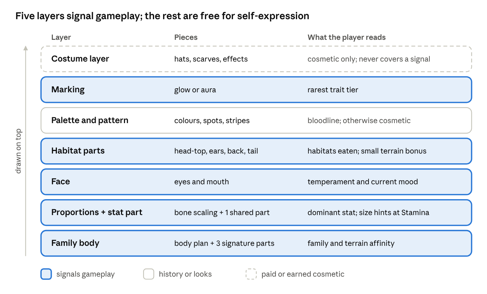

# Monster Bible

Six microhabitat families each have their own body plan and signature parts, and all of them draw on one shared pool of parts. This tab is the first pass at those families, plus the plan for finding, testing and locking every family and part before art production starts.

## Art style rules

The target is the Newgrounds Flash cartoon of the mid-2000s: simple vector shapes, thick outlines, flat colours, and bouncy, looping, slightly absurd animation (Badger Badger Badger is the reference). This style also happens to suit a modular parts system: Flash cartoons were built from separate pieces moved by tweens, which is exactly how Godot's 2D cutout rigs work.

**Look**

- Uniform thick outline on every part, one stroke weight across the whole game. Parts from different families must look like they belong together.
- Flat fills with at most one shade tone and one highlight. No gradients, no texture.
- Big heads, small bodies, oversized eyes. Simple geometric silhouettes: circle, bean, triangle, long rectangle.
- 3–5 colours per monster, laid out as fixed **palette slots** (base, belly, accent, detail, eye). A palette-swap shader recolours any part by slot, so one drawing yields many colour variants.
- Each monster must read at 96–128 pixels tall on a phone, which is the size it appears in garden and race views.

**Motion**

- Loops, not motion capture: a 6–12 frame idle, bounce or walk cycle, with squash and stretch on every landing.
- Every family has one **signature gag**: a short, slightly absurd idle beat that plays at random (see The six families). This is where the Flash-era humour lives.
- Big, readable reactions for competition moments: a win cheer, a loss flop, a hit spin, a scared shake. Death is a silly, affectionate send-off to the Great Heap (see the main tab), never violent.

**Constraints that keep the parts modular**

- Every body plan exposes the same named **sockets** (head-top, back, tail, left/right side, face). A shared part drawn for one socket must fit every family.
- Parts are drawn on a common grid at fixed size classes (small, medium, large), so any part scales cleanly to any body.
- Paid cosmetics live in their own **costume layer** and may never cover a part that signals gameplay (see Part slots and catalog).

**Sound**

- Each family gets a squeaky gibberish voice set: about 8–12 short clips (happy chirp, effort grunt, hurt squeak, cheer, sleepy mumble) plus a looping chant for its gag.
- Pitch follows size: bigger monsters sound deeper, so size reads by ear as well as by eye.
- Record in-house, as the Flash cartoons did: team members' voices, pitched up and sped up.

## Anatomy of a monster

Every monster is built from seven layers stacked on a family body. Five of them tell players something they need for gameplay; the rest are history and looks.



Layers are drawn bottom to top. The rule that matters for monetization: nothing in the costume layer may hide a gameplay layer.

## The six families

This is a first pass, meant to be argued over in the workshop (see The process). Each family comes from a small, overlooked habitat, not a classic element, so each one brings its own body plan, its own parts, and an obvious gag. All names are working names.

### Skimmers: pond surface

- **Concept:** water-strider bugs with frog faces, skating on surface tension.
- **Body plan:** a round little body on four needle-thin legs. Very wide stance.
- **Signature parts:** needle legs, ripple foot pads, reed antennae.
- **Gag:** stops mid-walk, slowly sinks bottom-first, pops back up looking surprised.
- **Apex:** *Lilypad Regent*, wearing a lily-pad cape and skating on its own wake.

### Mulchkins: rotting logs and leaf litter

- **Concept:** pill-bug rollers with mushroom caps. They're dense, slow and hit hard.
- **Body plan:** an armoured dome with stubby legs that curls into a ball.
- **Signature parts:** mushroom cap, armour plates, spore puffs.
- **Gag:** curls up to sneeze, rolls away off-screen, rolls back as if nothing happened (a nod to "mushroom, mushroom").
- **Apex:** *Old Stump*, a walking stump with a tiny forest on its back.

### Gutterlings: rooftops and rain gutters

- **Concept:** scrappy pigeon-gargoyles. Quick, nimble, easily distracted hoarders.
- **Body plan:** lanky legs, huge feet, tatty wings that glide but can't fly.
- **Signature parts:** tatty wings, bent-antenna crest, a hoard pouch that holds trinkets.
- **Gag:** pecks at nothing, finds a coin, hides it, forgets where it put it.
- **Apex:** *Weathervane*, which perches on a pole and spins with the wind.

### Puddlers: tide pools

- **Concept:** jelly anemone blobs that live in borrowed homes, like hermit crabs. Tough and patient.
- **Body plan:** a soft blob with suction feet and a "home" socket on its back.
- **Signature parts:** borrowed home (shell, teacup, bottle cap, old boot), frond tufts, suction feet.
- **Gag:** swaps its home for a slightly worse one and looks very pleased.
- **Apex:** *Grand Pool*, which carries an entire tide pool on its back.

### Glowmites: caves and cellars

- **Concept:** pale, big-eyed grubs with bat ears and a glowing tail lantern. Smart and skittish.
- **Body plan:** a segmented grub, giant ears, a lantern on the tail.
- **Signature parts:** lantern tail, giant ears, cave crystals.
- **Gag:** its light flickers out, only its panicking eyes show, then the light comes back on. The lantern's colour also shows its Mood, which doubles as UI.
- **Apex:** *Lanternwyrm*, a long glowing serpent of linked segments.

### Heaplings: compost heaps

- **Concept:** warm, steaming worm-snails made of layered peels and leaves. The generalist family, good for beginners.
- **Body plan:** a stacked, layered body like a little cairn, with a soft foot.
- **Signature parts:** peel layers, steam vents, sprouts.
- **Gag:** a sprout grows on its head; it notices and eats it.
- **Apex:** *Mother Heap*, a hill with eyes, with things growing out of it.

**Reserve habitats** for post-launch families: hedgerows, drainpipes, beehives, sandboxes, windowsill pots, dryer lint.

## Balance matrix

Each of the five stats is the main strength of exactly one family and the weakness of exactly one other. Heaplings are the even all-rounder. So every family is best at something, and none is good at everything.

| Family | Strong | Secondary | Weak | Terrain affinity | Best events | Common temperaments |
| --- | --- | --- | --- | --- | --- | --- |
| Skimmers | Speed | Agility | Power | Water surface, calm weather | Sprint Race, Wild Course | Bold, Hothead |
| Mulchkins | Power | Stamina | Wits | Mud, soft ground | Brawl | Lazy, Diligent |
| Gutterlings | Agility | Speed | Stamina | Heights, wind | Wild Course, Brawl | Hothead, Clever |
| Puddlers | Stamina | Wits | Agility | Rain, wet tracks | Brawl (outlasting), long Sprint Races | Diligent, Timid |
| Glowmites | Wits | Agility | Speed | Darkness, night cups | Wits Trial, Wild Course | Timid, Clever |
| Heaplings | None (even) | None | None | Heat | Any; their grades top out at A | Any |

**Balance rules**

- **Family sets tendencies, not limits.** A family tilts the grade odds at hatch, but fusion and training can still produce a fast Mulchkin. It's just rare, which makes it exciting.
- **Affinities stay small** (around +10%) and are always included in the win odds shown before entry, so no death comes as a surprise.
- **Ranked seasons rotate weather and terrain**, which changes which families are in favour without patching stats.
- **Balance targets for the sim:** no family wins much more than half its matches overall, and every family is a top-two pick in at least one event.

**Size and habitat parts also tilt a monster:**

- **Size:** bigger monsters lean toward higher Stamina grades and lower Agility; smaller ones the reverse. It's a trade-off, so no size is simply best.
- **Habitat parts:** each gives a small bonus (around +2%) on its own habitat's terrain. A monster's total terrain bonus, family plus parts, is capped at around +15%. Both are included in the odds shown before entry.
- **Risk to watch:** if one habitat's parts become the obvious pick, top monsters will start to look alike. Keep each bonus small, and use the Ranked weather rotation to change which habitat is in favour each season.

## Part slots and catalog

Every visible piece either tells the player something about gameplay or is clearly cosmetic. Players and Ranked opponents should be able to size up a monster at a glance: family from the body, best stat from proportions, temperament from the eyes, threat level from the marking.

| Slot | What it shows | How it's set | MVP count | Launch count |
| --- | --- | --- | --- | --- |
| Body | Family | Fixed at hatch | 3 | 6 |
| Signature parts | Family identity | Fixed; each family's own reserved sockets | 9 (3 per family) | 18 |
| Proportions | Dominant stat | Bone scaling at Adult evolution: no new drawings | 5 presets | 5 presets |
| Size | Stamina vs Agility tendency | Rolled at hatch, partly inherited: whole-body scaling | Scaling only | Scaling only |
| Stat part | Dominant stat | Added at Adult evolution; one shared part per stat that fits any body | 5 | 5 |
| Eyes | Temperament | Set at hatch | 6 | 6, plus expressions |
| Mouth | Current Mood | Follows the Mood meter | 4 | 6 |
| Head-top, ears, back, tail | Habitats it has eaten from, plus a small terrain bonus per part | Essences from food and foraging | 12 (3 habitats × 4 slots) | 24 |
| Pattern | Bloodline | Inherited through fusion; can mutate | 6 | 12 |
| Palette | Nothing: cosmetic | Random at hatch, inherited, rare palettes | 8 | 16 |
| Marking (glow or aura) | Rarest trait tier | Automatic: Rare, Epic or Mythic | 3 | 3 |
| Costume layer | Nothing: paid or earned cosmetic | Shop, season pass | 0 | about 20 per season |

The **habitat parts** are the originality engine. Feed a Mulchkin tide-pool food and it grows a Puddler frond. Monsters become visible records of how they were raised, and mixing habitats creates combinations nobody drew on purpose. Each part also gives a small terrain bonus for its habitat (see Balance matrix), so feeding is a strategy choice as well as a style one.

### Catalog template

Track every part in one spreadsheet from day one. It is the source of truth for art status and for the importer into Godot (see Technical approach on the main tab).

```csv
part_id,slot,family_or_habitat,size_class,palette_slots,source,rarity,gameplay_signal,status,owner
MLK_SIG_CAP_01,signature,Mulchkins,medium,base|accent,hatch,common,family,concept,
TDP_BACK_FROND_01,back,Tide pool,medium,accent|detail,essence,uncommon,habitat eaten,concept,
STAT_SPEED_FINS_01,stat part,shared,small,accent,adult evolution,common,dominant stat,concept,
```

## Evolution forms

At launch, each family needs one hatchling drawing, one adult body (reshaped five ways by bone scaling), and one hand-drawn Apex. That's 18 bodies in total instead of the 36 that unique drawings for every stat direction would need.

| Stage | What changes | Unique art per family | Example (Mulchkin) |
| --- | --- | --- | --- |
| Hatchling | Small, round and simple. Signature parts are only hinted at; no habitat parts yet | 1 body | A pea-sized dome with a button mushroom |
| Adult | Full body plan. Proportions and stat part follow the dominant stat; habitat parts appear from what it has eaten | 1 body, 5 proportion presets | **Power:** huge front plates, short legs. **Speed:** stretched, flatter, rolls faster |
| Apex | A hand-designed hero form, gated by Renown. It keeps the monster's palette, pattern and marking | 1 body | *Old Stump*, with a tiny forest on its back |

The Apex is the long-term chase for each family. Keep each one a surprise: show only a silhouette in the Fusion Codex until a player unlocks it.

## The process

Eleven steps take us from a blank page to a locked catalog. The cheap tests (silhouettes, scoring, the spreadsheet sim) come first, and no final art gets drawn until a family has passed them. Each step ends with a gate that has to be met before moving on.

1. **Lock the style.** Make a style tile, then fully rig one test monster (a Mulchkin) in Godot with idle, run, cheer, flop and its gag.
   - *Gate:* it reads clearly at 96 px on a phone, and the gag makes the team laugh.
2. **Run a habitat workshop** (half a day). Everyone brings five microhabitats; aim for 25 or more. Score each 1–5 on:
   - **Originality:** no obvious lookalike family in Pokémon, Digimon, Palworld or Slime Rancher.
   - **Silhouette:** a body plan unlike the others.
   - **Gameplay fit:** a stat and a terrain it naturally owns.
   - **Humour:** an obvious gag.
   - **Part yield:** it can give four good shared parts.
   - *Gate:* keep the top 6 plus 2 in reserve, and every stat is still owned by exactly one family. Rescore the first-pass six above alongside the newcomers.
3. **Write a creature brief per family.** One page each, covering:
   - habitat, concept, body plan and sockets
   - 3 signature parts, stat lean, terrain affinity
   - the gag and the Apex idea
   - 3 reference images, plus a "must not look like" list
4. **Silhouette test.** Draw all six adults as solid black shapes at 96 px, side by side. Ask people outside the team to tell them apart, and to tell the five proportion presets apart.
   - *Gate:* most testers get them right first time.
5. **Originality review.** Pin each family next to the closest existing creatures. Revise any family that playtesters can name a lookalike for.
6. **Socket spec.** Fix socket positions and size classes on every body, so shared parts can be drawn once.
7. **Habitat parts pass.** Draw four shared parts per habitat, and test each one on all six bodies.
8. **Random combination stress test.** A debug button in Godot builds 100 random monsters. Review them in one sheet, then redraw parts or add exclusion rules for broken combinations.
9. **Balance pass.** Feed family stat leans and affinities into the spreadsheet sim and the greybox.
   - *Gate:* the Balance matrix targets are met.
10. **Attachment playtest.** Show players 12 random monsters and ask which they would name, protect, or risk. A family nobody wants to protect needs more charm.
11. **Lock and schedule.** Mark parts "approved" in the catalog and schedule production. MVP: **Skimmers** (Race), **Mulchkins** (Brawl) and **Heaplings** (beginner all-rounder). The other three follow for launch.

## Monster workshop decisions

- [x] **Cross-family fusion:** decided. An opposed dice roll, weighted by total stat levels, picks one parent's family. Near-ties on hybrid pairs hatch a hybrid body. Full rules are in the Fusion section of the main tab.
- [x] **Readable eggs:** decided: full mystery. All eggs look alike until they hatch.
- [x] **Starter monster:** decided: the player picks 1 of 3 identical mystery eggs, which secretly hold one of each MVP family.
- [x] **Size variation:** decided: size varies and hints at Stamina, traded against Agility (see Balance matrix).
- [x] **Habitat parts and stats:** decided: each part gives a small, capped terrain bonus (see Balance matrix).
- [x] **Apex count:** decided: one per family at launch.
- [x] **Sound:** decided: a squeaky gibberish voice set per family (see Art style rules).
- [x] **Final names**: keep the working names for now, and lock them after the attachment playtest (step 10 of The process).
